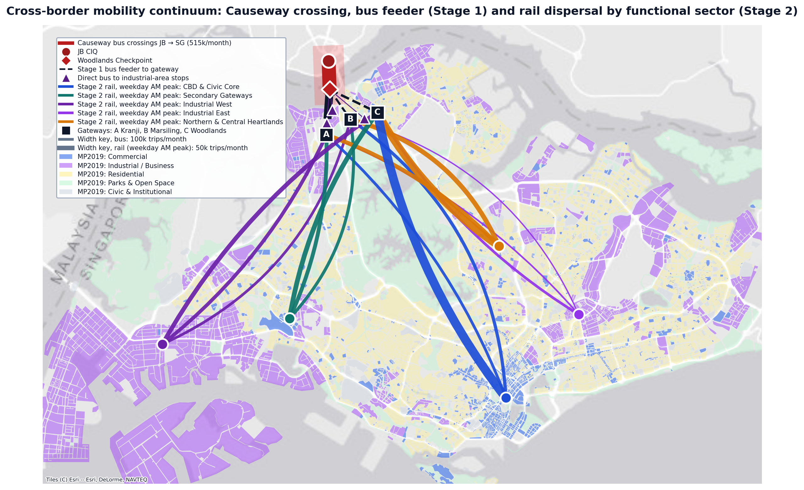
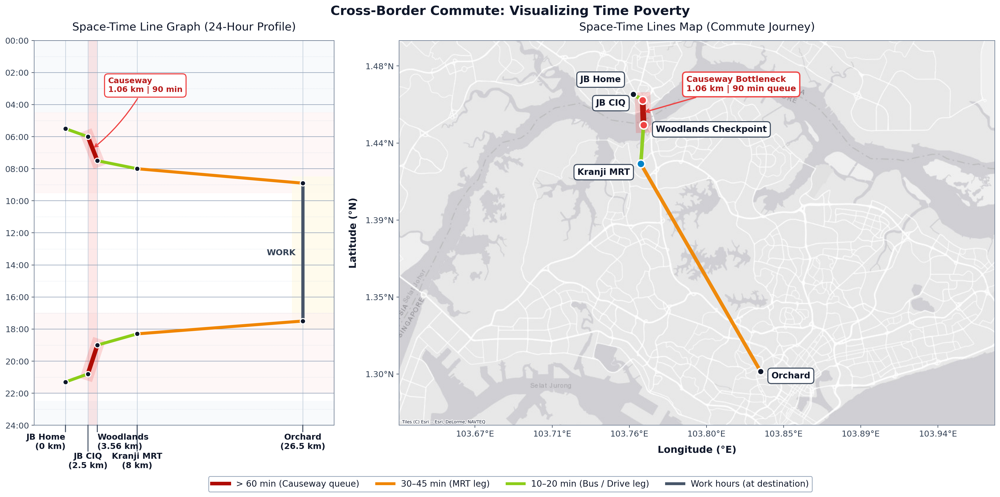
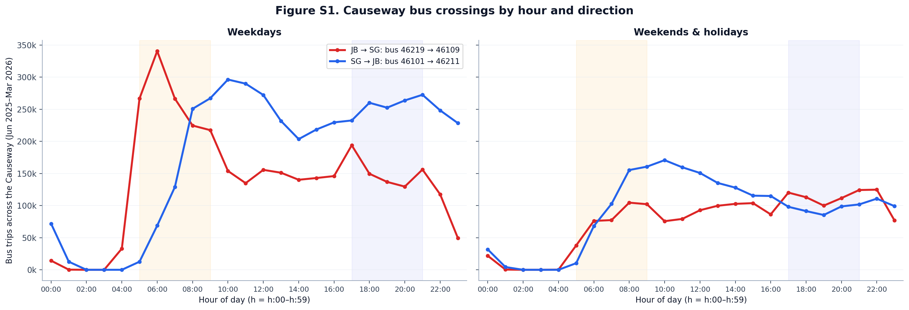

# crossborder-spacetime

Code, derived tables and figures for the analysis of cross-border commuting between
Johor Bahru (Malaysia) and Singapore across the Johor–Singapore Causeway: how many people
cross by bus, where they go next, when they travel, and what the daily journey costs
them in time.

The analysis combines ten months of public transport smart-card aggregates from the Land
Transport Authority of Singapore (**June 2025 – March 2026**) with interviews with
cross-border commuters, visualised as Hägerstrand space-time lines.

> **Citation.** This repository accompanies *The 17-Hour Workday: Spatiotemporal Patterns of Cross-Border Labor across the Johor–Singapore Causeway* (Tarozzo Kawasaki, Lee, Tan and Moeller; under review).
> A DOI will be added on publication; until then, please cite this repository (see [`CITATION.cff`](CITATION.cff)).

## Figure 1 — From the Causeway to the workplace



Bus crossings from JB into Singapore (red), the first bus leg from Woodlands Checkpoint to
the three gateway MRT stations A Kranji, B Marsiling and C Woodlands (dashed) or directly
to industrial-area stops (purple triangles), and weekday morning-peak rail trips from the
gateways to five functional sectors, over URA Master Plan 2019 land use. All line widths use
one linear scale (trips per month), computed from the tables.

## Figure 2 — Visualising time poverty



A representative commuter's day as a space-time line (left: distance along the commute vs
time of day) and on the map (right). The 1.06 km Causeway takes 60–90 minutes, an average
speed of 0.71–1.06 km/h.

## Method in brief

1. **Causeway crossings.** Bus trips from the JB Checkpoint stop (46219) to the Woodlands
   Checkpoint arrival stop (46109), and in the other direction from 46101 to 46211, from
   the LTA origin–destination bus data.
2. **Stage 1 – feeder leg.** Destinations of all onward bus trips boarded at 46109,
   grouped into the stops serving Kranji (45139, 45131), Marsiling (46521, 46529) and
   Woodlands (47009, Woodlands Temp Int) MRT stations, 13 industrial-area stops, and other.
3. **Rhythms.** Hourly profiles of crossings and boardings in each direction.
4. **Stage 2 – rail dispersal.** Weekday trips tapping in at Kranji (NS7), Marsiling (NS8)
   and Woodlands (NS9/TE2) between 06:00 and 09:59, by destination station, grouped into
   five functional sectors by keyword ([`stage2.py`](src/crossborder/stage2.py)).
5. **Space-time lines.** Interview-derived daily schedules drawn on a distance–time plane.

All definitions (period, stop and station codes, time windows) are in
[`src/crossborder/config.py`](src/crossborder/config.py).

## Reproducing the results

```bash
python -m venv .venv && source .venv/bin/activate
pip install -r requirements.txt pytest ruff   # Python 3.9-3.11
make figures   # redraw all figures from the committed tables (no raw data needed)
make all       # recompute every table from the raw LTA data, then draw the figures
make test      # unit tests on synthetic data
```

The pinned versions in `requirements.txt` reproduce the published tables and figures exactly
and install on Python 3.9–3.11. On newer Python versions, install the package with current
releases instead: `pip install -e ".[dev]"` (tests and `make figures` pass).

`make all` needs the raw files described in [`data/README.md`](data/README.md) (about
3 GB) and takes a few minutes.

| Script | Output | Used in |
|---|---|---|
| `scripts/01_check_inputs.py` | console check that all 40 monthly files are present | — |
| `scripts/02_build_reference.py` | `data/reference/landuse_mp2019.geojson`, station coordinates | Fig. 1, S2 |
| `scripts/03_stage1_bus.py` | `stage1_causeway_crossings.csv`, `stage1_feeder_split_46109.csv`, `stage1_top_destinations_46109.csv`, `stage1_industrial_clusters.csv`, `stage1_corridor_stops.csv` | Sec. 4.1 Stage 1, Fig. 1 |
| `scripts/04_rhythms.py` | `rhythms_checkpoint_hourly.csv`, `rhythms_industrial_hourly.csv` | Sec. 4.1 rhythms, Fig. S1, S3 |
| `scripts/05_stage2_rail.py` | `stage2_gateway_sector.csv`, `stage2_top10_per_gateway.csv`, `stage2_sensitivity_window.csv` | Sec. 4.1 Stage 2, Fig. 1, S2 |
| `scripts/06_figures.py` | `results/figures/*.png` and `*.pdf` | Fig. 1, 2, S1–S4 |
| `scripts/07_paper_numbers.py` | `paper_numbers.csv`: every number quoted in Sec. 4.1, with the script that produces it | whole section |

## Supplementary figures

**Figure S1.** Causeway bus crossings by hour and direction. JB → Singapore peaks at
06:00–06:59 on weekdays; Singapore → JB stays high from 10:00 to midnight.



- [Figure S2](results/figures/figS2_top10_per_gateway.png): top-10 rail destinations per gateway, weekday 06:00–09:59.
- [Figure S3](results/figures/figS3_industrial_rhythms.png): direct bus trips from the checkpoint to industrial-area stops, by hour.
- [Figure S4](results/figures/figS4_interview_spacetime.png): interview-derived space-time lines for four occupational profiles.

## Data

Raw LTA and URA data are not redistributed; [`data/README.md`](data/README.md) lists the
sources, licence and expected folder layout. The repository contains only aggregate tables
(`results/tables/`), small reference files (`data/reference/`) and stylised profiles
(`data/profiles/`).

### Qualitative data

The space-time profiles draw on 22 semi-structured interviews and 31 surveys with
cross-border commuters. Interview transcripts and survey responses are not shared, to
protect participants. The profiles in `data/profiles/commuter_profiles.yaml` are
pseudonymised, stylised composites: times are typical values reported by respondents, not
records of identifiable individuals.

## Repository structure

```
├── data/
│   ├── README.md            sources, licence, raw-data layout
│   ├── profiles/            stylised commuter profiles (YAML)
│   └── reference/           station/stop lookups, simplified land use
├── results/
│   ├── figures/             Fig. 1, 2 and S1–S4 (PNG 200 dpi + PDF)
│   └── tables/              aggregate tables and paper_numbers.csv
├── scripts/                 01–07, run in order (see Makefile)
├── src/crossborder/         config, loaders, analysis and plotting code
└── tests/                   unit tests on synthetic data
```

## Limitations

- The analysis covers cross-border **bus** travel only. JB → Singapore passengers are
  observed when they board an onward LTA bus at the Woodlands Checkpoint stop (46109),
  where all cross-border bus services stop for immigration clearance (99.8% of bus trips
  from the JB Checkpoint stop end there).
- Commuters who cross by train (Shuttle Tebrau), on foot, by motorcycle or by car are not
  captured. Some of them board LTA buses at other stops near the checkpoint, for example
  service 856 from the Woodlands Train Checkpoint stop (46069), which is outside the scope
  of this analysis.
- The LTA datasets are monthly aggregates of fare-card taps. They do not identify
  nationality or residence, so cross-border travellers are identified by where they board
  (the checkpoint stops), not by who they are. Passengers who pay without a card tap are
  not in the data.
- Bus origin–destination pairs record boarding and alighting stops of one bus leg; they do
  not link onward rail trips to the same person. Stage 2 counts **all** passengers tapping
  in at the gateway stations in the morning peak, of whom cross-border commuters are a
  part.
- Sector groupings use station-name keywords and are approximate. Stations not matched by
  any keyword (including the LRT lines) are grouped as "Other".
- Singapore → JB bus volumes include returning workers as well as leisure, shopping and
  other trips; the hourly profiles cannot separate them.
- Space-time profiles are stylised from interviews and are illustrative, not statistically
  representative.

## Licence

Code: [MIT](LICENSE). Derived data in `data/reference/` and `results/tables/`: Singapore
Open Data Licence, as for the source data.

## Acknowledgements

Contains information from LTA DataMall and from the URA Master Plan 2019 accessed via
data.gov.sg, made available under the Singapore Open Data Licence. Basemap tiles © Esri
(World Gray Canvas). We thank the commuters who took part in the interviews and surveys.
